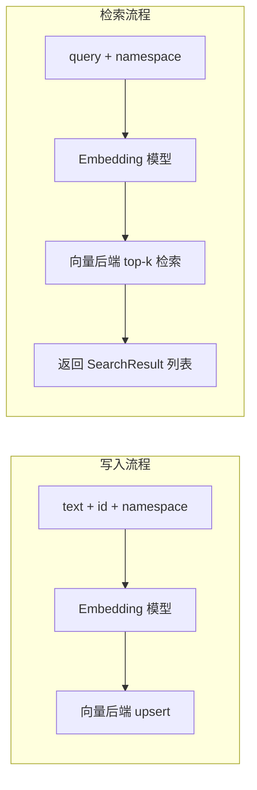

# vector-store

> 写作提醒：功能描述只写可观察的行为，不写内部实现细节。验收标准只写端到端可验证的行为。
> 共享基础设施模块，非用户可感知能力。

## 概述

共享向量索引基础设施，为 memory 和 knowledge_base 提供统一的 embedding 写入与相似度检索能力。

**负责**：文本 embedding、向量写入与更新、top-k 相似度检索、按 namespace 隔离不同来源的向量、按 source of truth 同步重建指定 namespace。

**不负责**：业务数据存储（→ memory / knowledge_base）、检索结果的业务过滤（如 TTL 过期判断，由调用方处理）、注入协调（→ long_term_ctx）。

**调用关系**：
- 依赖：embedding 模型（当前 deterministic，后续本地自托管 bge-m3 或 multilingual-e5）、向量后端（memory 或普通 SQLite persistent backend；sqlite-vec / Qdrant 后置）、config
- 被依赖：memory_layer（记忆条目的写入与检索）、knowledge_base（文档 chunk 的写入与检索）

**模块归属**：
- owning package：`intelligence.vector_store`
- public API：`upsert(id, text, namespace)`、`search(query, namespace, limit)`、`delete(id, namespace)`、`clear_namespace(namespace)`、`reindex(ReindexRequest)`、`SearchResult`、`IndexableItem`、`ReindexSummary`
- owned tables：`vector_items`（SQLite persistent backend owns）
- config namespace：`vector_store.*`、`embedding.*`、`rerank.*`

## 关键流程



## 接口定义

```python
@dataclass
class SearchResult:
    id: str       # 调用方写入时传入的 id，原样返回
    score: float  # 相似度分数，范围 0~1


async def upsert(id: str, text: str, namespace: str) -> None:
    """将文本 embedding 后写入向量索引。id 已存在时覆盖更新。
    namespace 用于隔离来源，memory 用 'mem:{user_id}'，knowledge 用 'kb:{tenant_id}:{kb_id}'。
    """


async def search(query: str, namespace: str, limit: int = 10) -> list[SearchResult]:
    """返回指定 namespace 内与 query 最相关的 top-k 条目。只返回 id 和 score，业务数据由调用方按 id 查询。"""


async def delete(id: str, namespace: str) -> None:
    """删除指定条目的向量。记忆过期或文档删除时由调用方触发。"""


async def clear_namespace(namespace: str) -> None:
    """删除指定 namespace 下的全部向量。用于同步 rebuild 前清理旧索引。"""


@dataclass
class IndexableItem:
    id: str
    content: str
    namespace: str
    metadata: dict[str, str]


@dataclass
class ReindexRequest:
    owner: str              # "memory" | "knowledge_base"
    mode: str = "rebuild"   # 当前仅支持 rebuild
    user_id: str | None = None
    tenant_id: str = "default"
    kb_id: str | None = None
    dry_run: bool = False


@dataclass
class ReindexSummary:
    owner: str
    namespace: str
    dry_run: bool
    scanned: int
    reindexed: int
    skipped: int
    failed: int


def reindex(request: ReindexRequest) -> ReindexSummary:
    """同步重建 memory 或 knowledge-base 的目标 vector namespace。"""
```

## 现状

**foundation 已完成**：`2026-05-31-vector-store-foundation` 已归档。

已实现内容：
- `fleetent.intelligence.vector_store` public API：`upsert()`、`search()`、`delete()`、`clear_namespace()`、`reindex()`、`SearchResult`、`IndexableItem`、`ReindexRequest`、`ReindexSummary`
- namespace helper：`memory_namespace(user_id)`、`knowledge_namespace(tenant_id, kb_id)`
- embedding provider abstraction：deterministic provider 用于测试和本地开发，HTTP provider 兼容
  OpenAI-style `/v1/embeddings`
- rerank provider abstraction：disabled / deterministic / HTTP provider 已定义，供后续 retrieval 流程使用
- in-memory vector backend，支持 namespace 隔离、upsert 覆盖、delete、score 排序
- 普通 SQLite persistent backend，使用 `vector_items` 表持久化 namespace-scoped vectors，检索时在 Python 内做 cosine similarity
- `vector_store.*` / `embedding.*` / `rerank.*` 基础配置命名空间
- `vector_store.database_url` 可选配置；未配置时 SQLite backend 复用全局 `Settings.database_url`
- 同步 reindex 边界支持 memory / knowledge-base 的 dry-run 和 rebuild；`rebuild` 先清空目标 namespace，再逐条 upsert 当前 source records，单条失败计入 failed 并继续后续 item

当前定位：可支持 memory-layer、long-term-ctx 和测试场景；SQLite backend 解决重启后索引丢失问题，但不是大规模 ANN 检索后端。
rerank provider 目前只提供边界，尚未接入 knowledge-base search。

## 规划中（v1.0）

- [x] **统一抽象接口**：upsert / search / delete 三个接口，后端实现可替换
  - 调用方不感知后端类型，切换后端不影响上层代码

- [ ] **sqlite-vec 后端**：轻量内嵌实现，适合开发环境和小规模部署
  - 无需额外服务，随主进程启动

- [x] **普通 SQLite persistent 后端**：不依赖 native extension，适合 on-premises MVP 和小规模部署
  - 向量以 JSON 存储，按 namespace 检索，Python 内计算 cosine similarity

- [ ] **Qdrant 后端**：生产级实现，Docker 自托管
  - 通过 config 切换，接口不变

- [ ] **OpenSearch / Elasticsearch adapter**：后置评估，更适合 knowledge-base lexical / hybrid search

- [x] **namespace 隔离**：不同来源的向量逻辑隔离，检索时不跨 namespace 返回结果

- [x] **同步 reindex 边界**：memory / knowledge-base 可从 source of truth 重建目标 namespace
  - 不包含后台 job、scheduler、worker、持久 job history 或 admin dashboard

## 当前缺口

- sqlite-vec / Qdrant 未实现：当前持久化后端是普通 SQLite + Python cosine，不提供 ANN 性能。
- 真实 embedding 可通过 HTTP provider 接入，但当前默认仍是 deterministic，需部署自托管
  embedding endpoint 后显式配置。
- rerank 尚未接入 knowledge-base search；当前只定义 provider abstraction。
- reindex 当前是同步 public API，尚未提供后台 job runtime、操作历史或管理界面。
- 缺少检索质量评估集：无法量化不同 embedding / backend 的召回质量差异。

## 下一批候选 specs

- `vector-store-sqlite-vec-backend`
- `rerank-kb-search-integration`
- `vector-store-retrieval-evaluation`

## 自动化效果验证缺口

- 构造中英文 query / document fixture，评估 top-k 命中率。
- 对比 deterministic / real embedding 的召回质量，避免只验证接口正确。
- 对 namespace、delete、overwrite 做持久化后端回归测试。

## 服务化 / 目录边界判断

vector-store 未来有独立服务潜力，尤其是 embedding provider 和 Qdrant 管理。但当前应保持模块化单体内的
`intelligence.vector_store` package：先稳定 public API 和 backend adapter，再决定是否拆成 sidecar 或独立服务。

## 验收标准

**场景 1：写入后可检索**
- Given：向 namespace A 写入一条文本
- When：在 namespace A 用语义相关的 query 检索
- Then：该条目出现在返回结果中，score 大于 0

**场景 2：namespace 隔离**
- Given：向 namespace A 和 namespace B 各写入内容
- When：在 namespace A 检索
- Then：返回结果中只包含 namespace A 的条目，不出现 namespace B 的内容

**场景 3：upsert 覆盖更新**
- Given：某 id 已有向量
- When：用同一 id 写入新文本
- Then：检索时返回新文本对应的向量，旧向量不再出现

**场景 4：delete 后不可检索**
- Given：某 id 已写入向量
- When：delete 该 id 后检索
- Then：该条目不再出现在任何检索结果中

**场景 5：rebuild 清理旧向量**
- Given：目标 namespace 中存在 stale vector，source of truth 中只存在当前记录
- When：调用同步 `reindex(ReindexRequest(..., mode="rebuild"))`
- Then：reindex 先清空目标 namespace，再写入当前记录；后续检索只返回当前记录

## 测试边界

**需要单元测试的行为**：
- namespace 隔离：写入 A 的内容不出现在 B 的检索结果
- upsert 幂等性：同一 id 重复写入，不产生重复条目
- delete 后检索不可见
- search 返回结果按 score 降序排列

**需要 mock 的依赖**：
- embedding provider：测试使用 deterministic provider 或 HTTP mock，隔离真实模型服务
- 向量后端：测试使用 in-memory backend 或 tmp SQLite DB，不依赖 Qdrant / sqlite-vec native extension

## 待决问题

- [x] 默认后端选型（MVP）：普通 SQLite persistent backend，避免 sqlite-vec native extension 的安装和 on-premises 兼容风险；sqlite-vec / Qdrant 后置评估。
- [x] embedding / rerank provider 边界：使用 HTTP provider 适配自托管或第三方 OpenAI-style API，默认仍为 deterministic / disabled，禁止静默 fallback。
- [ ] embedding 模型部署方式：自托管 HTTP sidecar 的具体运行时选型（`infinity_emb` / `text-embeddings-inference` / 其他）和运维配置。
  - in-process：部署简单，但 bge-m3 约 500MB-1GB 内存、冷启动 30-60s，影响主进程重启体验
  - HTTP sidecar：多 fleetent 实例可共享同一 embedding 服务，主进程重启不影响 embedding；两者均完全自托管
- [x] namespace 命名规范：memory 使用 `mem:{user_id}`；knowledge 使用 `kb:{tenant_id}:{kb_id}`。同一租户内允许多个知识库，并保留全局知识库与部门知识库并存的空间。
