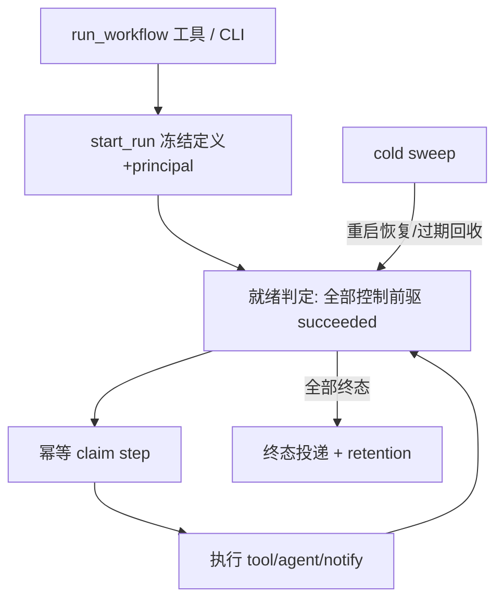

# Workflow 编排

> 写作提醒：功能描述只写可观察的行为，不写内部实现细节。

## 概述

声明式多步骤工作流编排（M1）。用 `workflow.yaml` 声明一个有向无环（DAG）的步骤序列，引擎在 agent 进程内持久化地驱动其执行到终态，支持断点续跑，步骤间以 `${...}` 字段映射传递数据，治理门控与对话路径一致（不旁路）。

负责：workflow 定义与校验、run/step 持久化、就绪判定与 DAG 执行、tool/agent/notify 三种步骤、断点续跑、终态投递。
不负责（M1）：循环、条件分支、显式审批步、跨进程多 agent 编排、流式字段映射、平台管理面。

**调用关系**：
- 依赖：`tools`（dispatch/schema）、`runtime`（loop/cancellation/snapshot/agent_state 迁移）、`governance`（action_gate 只读判定）、`outbound`（投递）
- 被依赖：`tools`（run_workflow/workflow_status 内置工具）、`runtime.agent_app`（boot 接线）

**模块归属**：
- owning package：`workflow`
- public API：`load_definition` / `list_definitions` / `parse_definition` / `WorkflowEngine` / `set_engine` / `get_engine` / `set_enabled` / `is_enabled` / `store.*`
- owned tables：`workflow_runs` / `workflow_step_runs`（agent_state.db）
- config namespace：`workflow.*`（`enabled` / `max_parallel`）；env `FLEETENT_WORKFLOWS_DIR`

## 关键流程



## 数据模型

```sql
workflow_runs (
  id, workflow_name, definition_json,  -- 冻结定义快照
  status,                              -- pending/running/succeeded/failed/cancelled
  inputs_json, principal_json, origin_json, deliver_json,
  error, created_at, started_at, ended_at
)
workflow_step_runs (
  run_id, step_id, attempt,            -- 联合主键
  status,                              -- pending/running/succeeded/failed/skipped/cancelled
  output_json, error, claimed_at, started_at, ended_at
)
```

## 现状

- ✅ **声明式定义**：`workflow.yaml` DAG，load 期校验（禁环/引用存在/tool schema 对照/占位符语法）
- ✅ **字段映射**：`${inputs.*}` / `${steps.<id>.output.*}` 点路径，单占位符保留类型，fail-closed
- ✅ **三种步骤**：tool（dispatch）、agent（loop.run 快照）、notify（outbound 投递）
- ✅ **持久化引擎**：热路径步进 + 冷路径 sweep、幂等 claim、并发上限、断点续跑
- ✅ **治理 fail-closed**：tool step 非 DIRECT 即失败；agent step 内部 awaiting_approval 即失败
- ✅ **触发面**：`run_workflow` / `workflow_status` 工具 + `fleetent workflow list|run` CLI

## 规划中

- [ ] **M2 审批**：风险触发审批挂起-恢复 + approve-always
- [ ] **M3**：显式 approval 步、定义级预授权、条件分支、跨进程多 agent 编排

## 验收标准

**场景 1：线性链执行**
- Given：一个 tool→agent→notify 的 workflow.yaml
- When：`run_workflow` 触发
- Then：按依赖顺序执行至 run succeeded，步骤间数据经字段映射传递

**场景 2：断点续跑**
- Given：一个执行到中途的 run，进程被 kill
- When：进程重启后 sweep 运行
- Then：已成功 step 不重跑，run 从断点续至终态

**场景 3：治理不旁路**
- Given：一个 tool step 引用需审批的工具
- When：run 执行到该 step
- Then：step 失败并说明需审批，run failed，工具未执行
