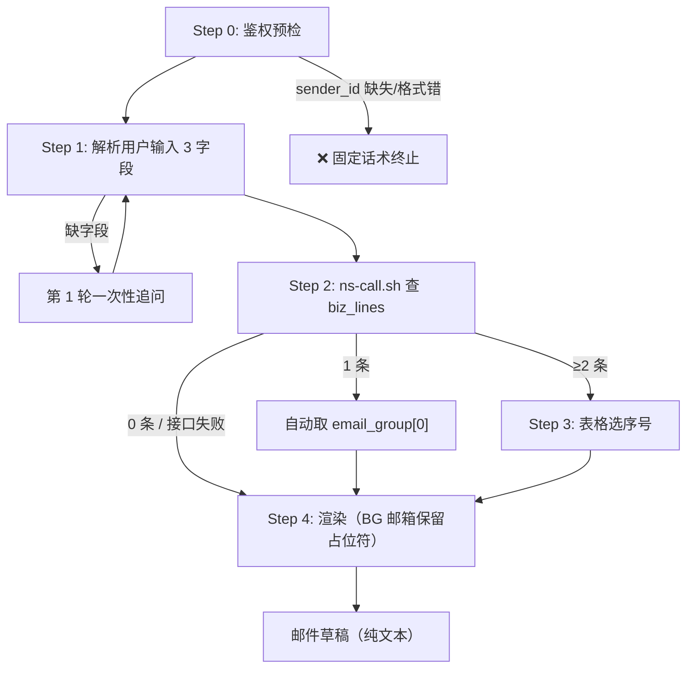

# 外部白名单邮件起草

## 使用场景

- **NL 触发**：
  - "@star 帮 Alpha Fund 走外部白名单，业务线量化"
  - "起草外部白名单邮件，客户 Grand Digital，NS-量化"
  - "Alpha Fund 这个客户要做外部白名单，业务线 Defi"
- **被其他 skill 调用**：M1 主流程节点 F；M2 子流程整体覆盖

> 注：触发场景只索要 **客户名称 + 业务线** 两个字段（详见下方「起草必备 3 字段」，language 默认 zh）。**严禁**把收币地址 / TRC20 地址 / 币种 / 网络等模板内空白字段当作触发或追问的内容——这些字段保持空白由发件人手填。

## 起草必备 3 字段

| 字段 | 必填 | 默认 | 来源 |
|------|------|------|------|
| `client_company` | 是 | — | 用户输入 |
| `business_line` | 是 | — | 用户输入（仅用于查 BG 邮箱，不写入邮件正文） |
| `language` | 否 | `zh` | 用户主动指定（中文/英文/双语）才覆盖默认 |

**字段封顶**：本 skill 只问以上 3 字段，**严禁**追问其他内容（如付款目的 / 注册国家 / 收币地址 / 币种 / 网络等）；这些字段在模板中保持空白，由发件人手填。模板若出现 3 字段以外的占位符（如 `{business_group_email}` / `{application_date}`），由 Step 2~3 自动补齐或保持原样兜底。

## 工作流程



---

## Step 0 — 鉴权预检（必须先做，失败立即终止）

1. 读取本轮 incoming 消息最顶部的 JSON 块，提取 `sender_id`
2. 校验：存在 + 匹配 `^U[A-Z0-9]{8,}$`
3. **任一失败** → 回固定话术并终止：

   > ❌ 此查询仅限 Slack 渠道使用。当前上下文无法识别 Slack 用户身份，已阻止 NS 系统查询。

4. 通过 → 把 `sender_id` 作为 Step 2 `ns-call.sh` 的 `<uid>` 首参传入。**严禁**绕过 `ns-call.sh` 直接发起 `armada__armada_get`（绕过 wrapper 鉴权会被 SKILL.tests.yaml 全局断言阻断）。

> **每轮 turn 开头必重新执行 Step 0**（防跨 turn 污染）。
>
> **Subagent 契约**：父 agent 通过 fleetent `sub_agent` 拉起本 skill 必须在 prompt 首行透传 `{"sender_id": "<父本轮 ToolContext.slackUserId>"}`，子 agent Step 0 自取。

---

## Step 1 — 解析用户输入（3 字段）

把用户消息（去掉 sender_id JSON 后的正文）按以下启发式拆分识别：

| 字段 | 识别规则 |
|------|---------|
| `client_company` | 段落含 `Limited / Holding / LLC / Inc / Ltd / 有限公司`，或最长的非业务线、非语言关键词的段落 |
| `business_line` | 命中已知业务线词：`量化 / Trading / Defi / RWA / 质押借贷 / 配资 / Prime / 矿业 / DEFI / staking ...` |
| `language` | 命中关键词 `中文` → `zh`、`英文 / English` → `en`、`双语 / bilingual` → `both`；**未命中即默认 `zh`，不视为缺失** |

**缺字段时**：第 1 轮一次性追问全部缺失字段，得到回复后回到本步重新解析。**只追问字段封顶范围内的字段**。

---

## Step 2 — 查 business_group_email

armada 在 fleetent 是 agent loop 发起的 MCP 工具调用（`armada__armada_get`，双下划线）。`ns-call.sh` 是「唯一合法入口」：它做 uid 校验 + 注入 `_meta.slackUserId`，把要发起的 armada 调用参数打印一行 `ARMADA_CALL` 到 stdout。

**① 用 `bash_exec` 跑 wrapper 拿 `ARMADA_CALL` 行**：

```bash
bash_exec: bash $SKILLS_DIR/common-ns-system-query/scripts/ns-call.sh \
  "<sender_id>" get "/v1/biz_lines" \
  'query_params={"page":1,"page_size":10,"name":"<business_line>"}'
```

- `<sender_id>` 替换为 Step 0 提取的实际 U-id（例：`"U01ABCDEF12"`）
- `<business_line>` 替换为 Step 1 解析的业务线名
- 脚本 stdout 形如：`ARMADA_CALL armada__armada_get path=/v1/biz_lines query_params={...} _meta={"slackUserId":"U..."}`

**② 据 `ARMADA_CALL` 行发起 `armada__armada_get` 工具调用**（参数 = 该行的 `path` + `query_params` + `_meta`），拿到 biz_lines 原始 JSON。**严禁**绕过 wrapper 直接发起 `armada__armada_get`（wrapper 通过首参 uid 注入 `_meta.slackUserId` 做鉴权，绕过即拒）。

**返回处理**（用 run_code 解析 JSON 后按候选数路由；只取 `list[]` 的每条 `name` + `email_group`，过滤 null/空串）：

- **0 条 或 接口失败（exit ≠ 0）** → 不追问用户，直接进 Step 4。`business_group_email` 在草稿中保留 `{business_group_email}` 占位符，由发件人手填。
- **1 条** → 业务线唯一即视为命中，自动取 `email_group[0]` 作为 `business_group_email`，进 Step 4。若该候选 `email_group` 为空或 `email_group[0]` 为空串 → 同 0 条逻辑（保留占位符）。
- **≥ 2 条** → 进 Step 3 表格让用户选业务线。**严禁**自动取首条 / 名称最相似一条 / 状态为 active 等启发式跳过表格——多条命中意味着选错风险。

> 用户选定业务线后，**该业务线内部** `email_group[0]` 仍允许自动取（邮箱层面无歧义）。

---

## Step 3 — 多业务线选择（仅 ≥ 2 条时）

展示候选表格：

```
🔎 找到 N 条候选业务线，请选序号：

| # | 业务线 | email_group |
|---|--------|------------|
| 1 | <name> | <email_group[0] 或 ―> |
| 2 | ...    | ... |
| N | ...    | ... |

回复序号 1-N 选择
```

收到 `1..N` → 取对应候选的 `email_group[0]`。若所选候选 `email_group` 为空或 `email_group[0]` 为空串 → 在草稿中保留 `{business_group_email}` 占位符。

**严禁默认行为**（≥ 2 条时）：
- **不得**自动取首条 / 状态为 active 一条 / 名称最相似一条
- **不得**因看起来"明显是某条"而跳过表格

**不允许的输入分支**：本 skill 不接受「重新搜索 / 重输关键词」操作，避免追加问询；用户若发非数字回复，按 `0 条` 路径处理（保留占位符直接渲染）。

---

## Step 4 — 渲染邮件草稿（必须走脚本，禁止 AI 自己拼字符串）

**唯一合法入口**：`scripts/render-email.py`。AI **严禁** `cat` 模板再做字符串替换 / 拼接 / 追问字段缺失，所有渲染逻辑下沉到脚本，避免 AI 自由发挥导致跑题或胡乱追问用户。

```bash
bash_exec: python3 ${SKILLS_DIR}/bs-external-whitelist-coordinating/scripts/render-email.py \
  --lang <zh|en|both> \
  --json '{"client_company":"<Step 1 输入>","business_group_email":"<Step 2~3 取值>","application_date":"<可省，脚本自动用 now>"}'
```

**入参约定**

| JSON 字段 | 来源 | 缺值处理 |
|-----------|------|----------|
| `client_company` | Step 1 用户输入 | 保留 `{client_company}` 字面量 |
| `business_group_email` | Step 2~3；0 候选/接口失败/email_group 空 → 不传该字段 | 保留 `{business_group_email}` 字面量 |
| `application_date` | 一般省略 | 脚本用当前时间 `YYYY-MM-DD HH:mm:ss` |

**`--lang` 取值**

| language | --lang | 输出 |
|----------|--------|------|
| `zh` | `zh` | 中文版（默认） |
| `en` | `en` | 英文版 |
| `双语 / both` | `both` | 中文版 + 分隔线 + 英文版 |

**退出码**

| code | 含义 | 处理 |
|------|------|------|
| 0 | 成功 | 把 stdout 直接交给用户 |
| 2 | JSON 解析失败 / 顶层非对象 | 视为内部错误，回复「邮件渲染脚本入参异常，请重试」并终止 |
| 3 | 模板文件缺失 | 回复「外部白名单模板文件缺失，联系管理员补充 `templates/email-*.txt`」并终止 |

**输出纪律**

- 直接把脚本 stdout 作为草稿输出，**不要**包 markdown 代码块、**不要**改写、**不要**追加说明
- 正文里的空白字段（公司法定名称 / 涉及业务线 / 付款目的 / 注册国家 / 地址 / 币种 / 网络 / `因 xxxxx`）保持空白由发件人手填，AI **严禁**追问

---

## 异常处理

| 异常 | 处理 |
|------|------|
| 鉴权失败（`sender_id` 缺失/格式错） | Step 0 固定话术终止 |
| `ns-call.sh` 调用失败（exit ≠ 0） | 按 Step 2 的「0 条」路径走，保留 `{business_group_email}` 占位符渲染 |
| 业务线 0 候选 / `email_group` 为空 | 同上 |
| 模板文件缺失（render-email.py exit 3） | 回复「外部白名单模板文件缺失，联系管理员补充 `templates/email-*.txt`」并终止 |
| 渲染入参异常（render-email.py exit 2） | 回复「邮件渲染脚本入参异常，请重试」并终止；不允许 AI 改走"自己拼"路径 |
| MCP / 网络异常 | 同 ns-call.sh 失败处理 |
