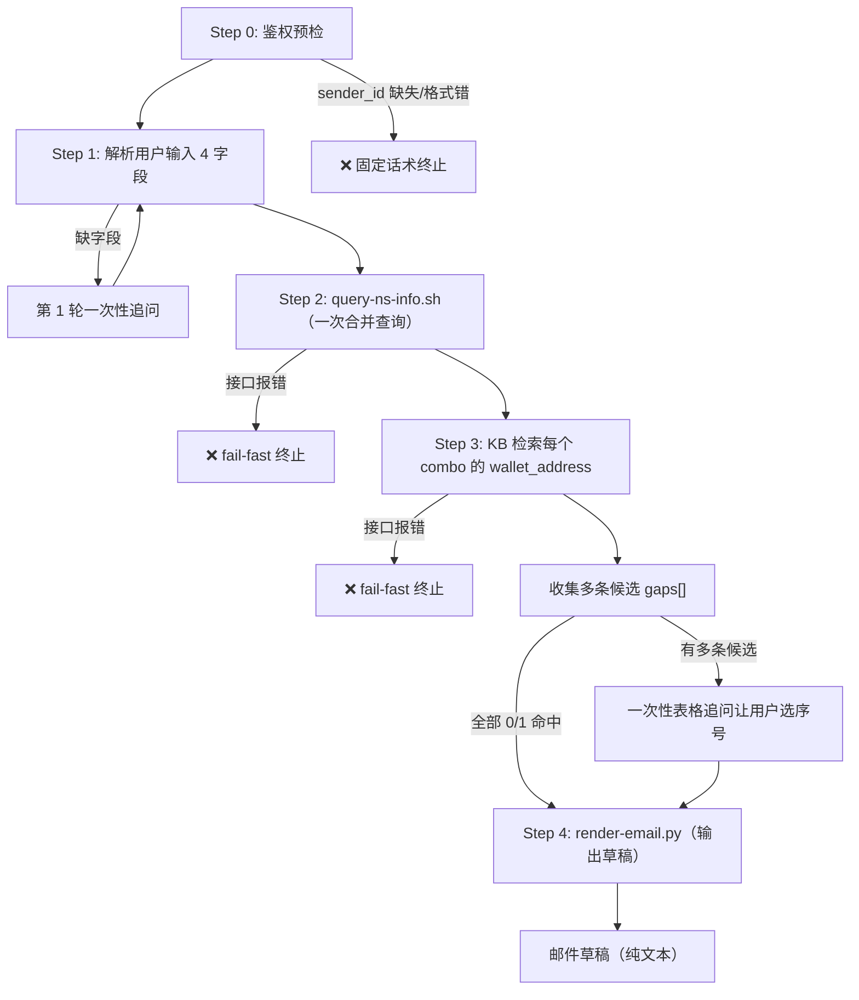

# 内部白名单邮件草拟

## 使用场景

### 触发
- **NL 触发（紧凑式，一次性给字段）**：
  - `中文， Grand Digital Holding Limited，量化， USDT erc20， USDT trc20， BTC`
  - `@star 出一份内部白名单邮件，量化业务，Grand Digital 客户，要 USDT erc20、USDT trc20、BTC`
  - `BS 内部白名单：英文版，ABC LLC，Defi，USDT TRC20`
- **被其他 skill 调用**：M1 主流程节点 J（子账户完成后触发）

> **Subagent 透传协议**：M1 主流程通过 fleetent `sub_agent` 拉起本 skill 时，父 agent **必须**在 prompt 参数最前面原样插入一行 JSON：`{"sender_id": "<父本轮 ToolContext.slackUserId>"}`，正文从下一行开始。否则 Step 0 鉴权会拒。

### 一次性原则
- 用户一次性给完字段；skill 一次性并发跑完所有查询；所有不确定项合并**一条消息**追问，**永远不要拆多次问**
- 理想路径：用户初始消息给全字段、查询全部单命中 → **0 轮追问**直接出稿

## 前置条件

- 本地模版已固化在 `${SKILLS_DIR}/bs-internal-whitelist-drafting/templates/email-zh.txt` / `email-en.txt`
- 渲染脚本 `scripts/render-email.py`（Python 3）+ NS 查询脚本 `scripts/query-ns-info.sh` 已部署
- `knowledge-bridge` MCP server 已配置（KB 钱包地址检索用 `knowledge-bridge__knowledge_search`）
- `armada` MCP server 已配置（NS `/v1/customers` + `/v1/biz_lines` 查询用 `armada__armada_get`）
- KB 已索引「NS常规对外收款地址清单.xlsx」

## 起草必备 4 字段

| 字段 | 必填 | 默认 | 来源 |
|------|------|------|------|
| `client_company` | 是 | — | 用户输入 |
| `business_line` | 是 | — | 用户输入 |
| `combos` (币种 + 网络元组列表) | 是 | — | 用户输入 |
| `language` | 否 | `zh` | 用户主动指定（中文/英文/双语）才覆盖默认 |

**字段封顶**：本 skill 只问以上 4 字段，**严禁**追问其他内容（如客户注册国家 / 关键人邮箱 / 项目编号等）；模版若出现 4 字段以外的占位符，渲染脚本会自动用占位符兜底。

## 工作流程



---

## Step 0 — 鉴权预检（必须先做，失败立即终止）

1. 读取本轮 incoming 消息最顶部的 JSON 块，提取 `sender_id`
2. 校验：存在 + 匹配 `^U[A-Z0-9]{8,}$`
3. **任一失败** → 回固定话术并终止：

   > ❌ 此查询仅限 Slack 渠道使用。当前上下文无法识别 Slack 用户身份，已阻止 NS 系统查询。

4. 通过 → 把 `sender_id` 作为本轮所有脚本调用的 `<uid>` 参数传入。**严禁**绕过 `query-ns-info.sh` / `ns-call.sh` 直接发起 `armada__armada_get`（wrapper 通过首参 uid 注入 `_meta.slackUserId` 做鉴权，绕过即视为越权）。

> **每轮 turn 开头必重新执行 Step 0**（防跨 turn 污染）。
>
> **Subagent 契约**：父 agent 通过 fleetent `sub_agent` 拉起本 skill 必须在 prompt 首行透传 `{"sender_id": "<父本轮 ToolContext.slackUserId>"}`，子 agent Step 0 自取。

---

## Step 1 — 解析用户输入（4 字段）

把用户消息（去掉 sender_id JSON 后的正文）按以下启发式拆分识别：

| 字段 | 识别规则 |
|------|---------|
| `client_company` | 段落含 `Limited / Holding / LLC / Inc / Ltd / 有限公司`，或最长的非币种、非业务线、非语言、非已知关键词的段落 |
| `business_line` | 命中已知业务线词：`量化 / Trading / Defi / RWA / 质押借贷 / 配资 / Prime / 矿业 / DEFI / staking ...` |
| `combos` | 剩余段落，每段尝试解析为 `(currency, chain_name)` 二元组：第一个 token 视为 currency（如 USDT、BTC、ETH），后跟 token 视为 chain（erc20、trc20、bep20、Polygon、Bitcoin）；chain 缺省允许 |
| `language` | 命中关键词 `中文` → `zh`、`英文 / English` → `en`、`双语 / bilingual` → `both`；**未命中即默认 `zh`，不视为缺失** |

分隔符：英文逗号 `,`、中文逗号 `，`、顿号 `、` 任一可分。

**示例**：
- 输入：`中文， Grand Digital Holding Limited，量化， USDT erc20， USDT trc20， BTC`
- 解析：
  - `client_company = Grand Digital Holding Limited`
  - `business_line = 量化`
  - `combos = [(USDT, erc20), (USDT, trc20), (BTC, "")]`
  - `language = zh`

**缺字段 → 第 1 轮一次性追问**（仅检查 `client_company / business_line / combos`，language 不缺）：

```
还需要以下信息才能起草邮件，请补齐：
{若缺 client_company} 1. 客户公司全称（如 Grand Digital Holding Limited）
{若缺 business_line} 2. 业务线（如 量化 / Trading / Defi / RWA / ...）
{若缺 combos} 3. 币种和网络（可多组，例 USDT erc20、USDT trc20、BTC）
```

最多追问 2 次仍不全 → 告诉用户字段不全无法继续。

---

## Step 2 — NS 信息查询（两步交互：wrapper 出参 → armada 工具调用 → run_code 合并）

armada 在 fleetent 是 agent loop 发起的 MCP 工具调用（`armada__armada_get`，双下划线），沙箱内**没有** mcpfast。`query-ns-info.sh` 是「唯一合法入口」：它做 uid 校验 + 注入 `_meta.slackUserId`，把 customers / biz_lines 两路要发起的 armada 调用参数各打印一行 `ARMADA_CALL` 到 stdout。

**① 用 `bash_exec` 跑脚本拿两行 `ARMADA_CALL`**：

```bash
bash_exec: bash $SKILLS_DIR/bs-internal-whitelist-drafting/scripts/query-ns-info.sh \
  "$UID" "{client_company}" "{business_line}"
```

> `"$UID"` 替换为 Step 0 提取的 `sender_id`。脚本 stdout 形如（恰好两行，customers 在前）：
> ```
> ARMADA_CALL armada__armada_get path=/v1/customers query_params={"page":1,"page_size":20,"name":"..."} _meta={"slackUserId":"U..."}
> ARMADA_CALL armada__armada_get path=/v1/biz_lines query_params={"page":1,"page_size":10,"name":"..."} _meta={"slackUserId":"U..."}
> ```

**② 据每行 `ARMADA_CALL` 逐个发起 `armada__armada_get` 工具调用**（参数 = 该行的 `path` + `query_params` + `_meta`），分别拿到 customers / biz_lines 的原始 JSON。

**③ 把两个 JSON 结果喂回 `run_code` 做字段裁剪合并**，得到下面这个精简结构：

```json
{
  "customers": [
    {"name": "xn新客户-NS量化", "email": []},
    {"name": "量化测试员", "email": ["a@x.com"]},
    ...
  ],
  "biz_lines": [
    {"name": "NS-量化", "email_group": ["a@nsdigital.io", "b@nsdigital.io"]},
    {"name": "TEST-量化", "email_group": []},
    ...
  ]
}
```

> run_code 里对两路 JSON 各自：只取 `list[]`（丢弃 `page_info` / `total`）；customers 每条保留 `name` + `email`，biz_lines 每条保留 `name` + `email_group`；`email` / `email_group` 数组里的 `null` 和空字符串过滤掉（NS 返回 `[""]` 等同于 `[]`）。然后基于 `email`/`email_group` 是否为空数组判断三态。

**fail-fast**：脚本 exit !=0（uid 鉴权失败 / 参数缺失），或任一 `armada__armada_get` 报错 / 返回非合法 JSON → 告诉用户「NS 查询失败：{原因}」终止，**不重试**。

### 2.1 处理 biz_lines / customers — **三态统一规则**

| 命中数 | 处理（biz_lines / customers 通用） |
|--------|----------------------------------|
| **0** | 不进 gaps，不询问；对应字段保持空数组（渲染脚本会兜底为占位符 `<业务群组待补充>` / `<待客户联系人邮箱>`） |
| **1** | 不进 gaps，不询问；直接取该条的 `email_group` / `email` 数组（无论是否为空，空就是空，空时由渲染脚本兜底为占位符） |
| **>1** | 进 gaps：`biz_line_multi` / `customer_multi` — 用**表格**展示候选让用户选序号 |

> **取消的边界分支（v5.1.0 简化）**：
> - ❌ 不再有"1 命中但 email 空 → 追问用户提供"路径
> - ❌ 不再有"客户全部 email 空 → 忽略"特殊路径
> - ❌ 不再提供"跳过"选项
>
> **🔒 多条候选展示规则**：当 customers / biz_lines >1 命中时，**不论 email / email_group 是否为空，所有候选都必须展示在表格里**（用户输入的客户名往往是模糊关键词，需要看到完整候选列表自行判断哪一条是目标）。**严禁**因 email 字段为空就把某条候选从表格里过滤掉。
>
> **🔒 严禁在"业务线 / 客户 / 钱包地址"层面自动选择或合并候选**（违反 = 错误执行）
>
> 当 biz_lines / customers / wallet_address 任一查询返回 **>1 条**时，**必须**通过表格让用户回复序号选 1 条，**严禁**：
> - ❌ 自动取**候选数组**的第 1 条（如 biz_lines >1 时直接用 `biz_lines[0]`，不让用户选）
> - ❌ 把**多条候选**的 `email_group` / `email` 数组合并到一起填入字段（典型错误：5 条业务线候选 → 把 5 条的 email_group 累加进 cc）
> - ❌ 跳过表格追问直接进 Step 4
>
> **澄清**：`email_group[0]` / `email[0]` 指**选定的某 1 条业务线 / 客户**自身邮箱数组的第一个元素——这是**允许**的，跟"多候选自动选第 1 条"完全不同。这里禁止的是"在 biz_lines / customers / wallet_address **候选层**自动取 [0]"，不是"在选定的单条记录的邮箱数组层取 [0]"。
>
> **❌/✅ 反例对照**（业务线 `量化` 返回 5 条候选 `[NS-量化, TEST-量化, NN-量化, NS-量化（子）, NS-NS-量化]`）：
>
> ❌ 错误（直接合并所有候选的 email_group 进 cc）：
> ```
> business_group_email = NS-量化.email_group + NN-量化.email_group + ...
> ```
>
> ✅ 正确：进 gaps `biz_line_multi` → 在"一次性追问"里输出表格 → 用户回复 `1` → 取 NS-量化 单条的 `email_group`（无论该业务线 email_group 是否为空都直接采用，**空就空**，由渲染脚本兜底为 `<业务群组待补充>` 占位符出稿，**绝不**因此再追问或忽略）

---

## Step 3 — KB 检索 wallet_address（每 combo）

对 `combos[]` 每一项 `(currency, chain_name)`，发起一次 `knowledge-bridge__knowledge_search` 工具调用：

```
knowledge-bridge__knowledge_search
  query="NS常规对外收款地址清单 {business_line} {currency} {chain_name}"
  agent_id="bs-intern"
  top_k=20
```

`{chain_name}` 为空时 query 省略该 token。多个 combo 可在同一轮内并行发起多个工具调用。完整 SOP 见 `skills/common-knowledge-search/SKILL.md`。

> **`agent_id` 必填**：`knowledge_search` 必须带 `agent_id="bs-intern"`（本部署 KB 注册的消费者 id）。
> **严禁**省略，也**严禁**改用 `my-bot`/`default`/Slack ID 等猜测值（会返回 `400 Unknown agent_id`）。

**fail-fast（不重试、不空转换 agent_id）**：带 `agent_id="bs-intern"` 仍报错 / 超时 / 非 2xx（如 `500`）/ 非合法 JSON 时，
**不重试**、**不换 agent_id**。按以下降级：将该 combo 的 `wallet_address` 置 `null`（渲染脚本兜底为占位符
`<待业务/中台确认>`），**照常渲染出稿**，并在最终回复顶部以一行提示用户「⚠️ 收款地址清单查询暂不可用（{原因}），
邮件中的钱包地址为占位符，请人工补全后再发送」。这样即使 KB 不可用，也能产出可人工补全的邮件草稿，而非整体失败。

每条 chunk 的 `content` 字段是该 sheet 的一行（或邻近几行）拼接，覆盖列：`序号 / 平台 / 账户名称 / 账户编码 / 账户标签 / 币种网络 / 币种 / 场景 / 地址`。

**Score + 行级筛选**（每 combo）：

1. **Score 门槛**：`top-1 score < 0.85` 视为未命中（按 0 命中处理）
2. **行级筛选**（在达标 chunks 上做）：
   - 「币种」字段大小写不敏感等于 `currency`
   - 「币种网络」字段大小写不敏感等于 `chain_name`（chain 为空时跳过此条件）
   - 「场景」字段包含 `business_line`（子串匹配）
3. **去重**：按「地址」字段去重

**结果分类**（与 Step 2.1 同样的三态规则）：

| 通过筛选后命中数 | 处理 |
|--------|------|
| **0**（含 score 不达标） | 不进 gaps，不询问；`wallet_address[combo_i] = null`（渲染脚本兜底为 `<待业务/中台确认>`） |
| **1** | 取「地址」字段填入 `wallet_address[combo_i]` |
| **>1** | 进 gaps：`address_multi_match` — 用表格展示 N 行候选让用户选序号；地址 mask（前 6 后 4 中间 `***`）。**表格必须至少包含 5 列：序号 / 账户名称 / 场景 / 币种网络 / 地址（mask）**——「账户名称」和「场景」是用户区分候选的关键依据，**严禁省略** |

---

## 一次性追问（仅当多条命中时执行）

只在**多条命中需要选择**时触发一次。把所有需要选择的项合并成**一条消息**，每项一个 markdown **表格**展示候选，**严禁拆多条消息**。**没有"跳过"选项**——多条命中必须选 1 条，否则不出稿。

```
匹配到多条候选，请逐项选择序号：

{若有 biz_line_multi}
**业务线候选**（业务线名 = 「{business_line}」）：

| # | 名称 | email_group |
|---|------|-------------|
| 1 | NS-量化 | le.chang+qt@nsdigital.io, ning.xu@nsdigital.io, ... |
| 2 | TEST-量化 | （空） |
| 3 | NN-量化 | ning.xu@nsdigital.io |
| ... |

{若有 customer_multi}
**客户候选**（客户名 = 「{client_company}」）：

| # | 名称 | email |
|---|------|-------|
| 1 | xn新客户-NS量化 | （空） |
| 2 | 量化测试员 | a@x.com |
| ... |

{若有 address_multi_match (combo_j)}
**收款地址候选**（`{currency_j} ({chain_name_j})`，地址已 mask）：

**至少必须有以下 5 列**（「账户名称」和「场景」**严禁省略**——是用户辨别候选的关键依据）：

| # | 账户名称 | 场景 | 币种网络 | 地址 |
|---|---------|------|---------|------|
| 1 | Binance-子账户A | 量化-XX | ERC20 | 0xabc12***5678 |
| 2 | Coinbase-主账户 | 量化-YY | ERC20 | 0xdef34***9012 |
| ... |
```

请按以下格式回复：业务线 N，客户 N，地址 (combo X) N。

**地址 mask 规则**（候选展示用）：
- 长度 ≥ 12：前 6 字符 + `***` + 后 4 字符
- 长度 < 12：全 mask 为 `***`

**用户回复处理**：

- 用户回复合法序号 → 填入对应字段
- 用户回复非法 / 留空 → 不再二次追问，**直接提示用户重新回复**（不允许"跳过"）

完成后进 Step 4。

---

## Step 4 — 渲染输出（一次脚本调用）

把所有字段拼成 JSON，调渲染脚本：

```bash
bash_exec: python3 $SKILLS_DIR/bs-internal-whitelist-drafting/scripts/render-email.py \
  --lang {language} \
  --json '{"client_company":"...","business_line":"...","application_date":"YYYY-MM-DD","client_contact_email":"...","business_group_email":[...],"combos":[{"currency":"...","chain_name":"...","wallet_address":"..."}, ...]}'
```

或更稳妥地把 JSON 写 workspace 临时文件再传 `--json-file`（避免 shell 转义 JSON 出错）：

```bash
bash_exec: cat > wl-payload.json <<'JSON'
{
  "client_company": "...",
  "business_line": "...",
  "application_date": "YYYY-MM-DD",
  "client_contact_email": "...",
  "business_group_email": [...],
  "combos": [{"currency":"...","chain_name":"...","wallet_address":"..."}, ...]
}
JSON
bash_exec: python3 $SKILLS_DIR/bs-internal-whitelist-drafting/scripts/render-email.py \
  --lang {language} --json-file wl-payload.json
```

**`language=both` 时**：分别用 `--lang zh` 和 `--lang en` 调两次，把两次输出**先中文后英文，中间空一行**拼起来给用户。

**输出展示**：脚本 stdout 就是最终邮件草稿（纯文本），**直接展示给用户，不加任何前后说明性文字**，**不二次加工**。

> **🔒 输出绝对禁止做的事**（违反 = 错误执行）
>
> 把 `render-email.py` 的 stdout **一字不改、一字不增、一字不减**地输出给用户。**严禁**：
> - ❌ 在脚本输出**前**加任何说明文字（如"以下是邮件草稿："、"已为您渲染..."、"请检查"等）
> - ❌ 在脚本输出**后**加任何额外区块（如「客户信息」、「业务线信息」、「钱包地址说明」、「使用提示」、汇总表格等）
> - ❌ 把脚本输出的某段拆开重排 / 翻译 / 改写文案
> - ❌ 把脚本输出包到 markdown 代码块里（` ``` `）
>
> ✅ 正确做法：脚本 stdout 是什么，用户看到的就是什么。

> **🔒 渲染规则全部封装在脚本里**——AI 不做任何模版字符串拼接 / 占位符替换 / 多行展开 / markdown 处理。AI 只负责传入正确的 JSON。脚本承担所有 verbatim 复制 + 缺值兜底（缺值替换为 `<待业务/中台确认>` / `<业务群组待补充>` / `<待客户联系人邮箱>` 等）。

---

## 不做什么 / 边界

- 不做邮件发送（BS 人工）
- 不做中台地址创建 / 更新（BS 在中台 UI）
- 不监听 Owen 邮件回复
- 不做币种 ↔ 链合法性校验
- 不做收款地址清单的写入 / 修改

## 异常处理

### fail-fast（直接终止，不重试不降级）

| 异常 | 处理 |
|------|------|
| `sender_id` 缺失 / 不匹配 `^U[A-Z0-9]{8,}$` | Step 0 固定话术终止 |
| Subagent Step 0 失败（父未透传 sender_id） | 同上；责任在 parent 侧 |
| `query-ns-info.sh` exit !=0 / `armada__armada_get` 报错 / 返回非合法 JSON | 告诉用户「NS 查询失败：{原因}」终止 |
| `knowledge-bridge__knowledge_search` 接口报错 / 超时 / 非合法 JSON | 告诉用户「收款地址清单查询失败：{原因}」终止 |
| `render-email.py` exit !=0 | 告诉用户「邮件渲染失败：{stderr}」终止 |
| 模版文件缺失（脚本报 `ERR_TEMPLATE_NOT_FOUND`） | 告诉用户「本地模版缺失，请重新部署 skill」终止 |
| MCP 连接失败（armada / knowledge-bridge 不可用） | 告诉用户「MCP 连接失败，请检查对应 MCP server 状态」终止 |

### 不阻塞出稿（缺值占位符照常出稿，全部由渲染脚本兜底）

| 情况 | 邮件草稿里 |
|------|----------|
| `business_group_email` 0 命中 / 1 命中但 email_group 为空 | cc 行 `<业务群组待补充>` |
| `client_contact_email` 0 命中 / 1 命中但 email 为空 | cc 行 `<待客户联系人邮箱>` |
| `wallet_address[i]` KB 0 命中（含 score 不达标） | 该地址行 `<待业务/中台确认>` |

### 安全 / 隐私

- 完整地址仅出现在最终邮件草稿正文
- Slack / 日志 / gaps 候选展示时地址 mask（前 6 后 4，中间 `***`）

### 幂等性

完全幂等（NS / KB 只读 + 模版渲染无副作用）。

## 依赖

- `scripts/query-ns-info.sh` — NS 双查询合并脚本（v5.0.0 新增）
- `scripts/render-email.py` — 模版渲染脚本（v5.0.0 新增）
- `templates/email-zh.txt` / `templates/email-en.txt` — 本地固化模版（v5.0.0 新增，从 GDrive 模版固化）
- `common-ns-system-query/scripts/ns-call.sh` — `query-ns-info.sh` 内部调用
- `common-knowledge-search` — KB 检索 SOP（Step 3 引用）
- KB 索引文档「NS常规对外收款地址清单.xlsx」

### 已退役依赖（v5.0.0）

- `common-email-draft-gdrive` — 改用本地固化模版后不再需要
- GDrive 邮件模版动态下载链路（`google-drive__downloadFile` + pandoc 转换）— 改用本地 `templates/`
- 散落的占位符规则（旧 4.3 / 5.4 / 5.5 / 5.2）— 全部封装到 `render-email.py`
